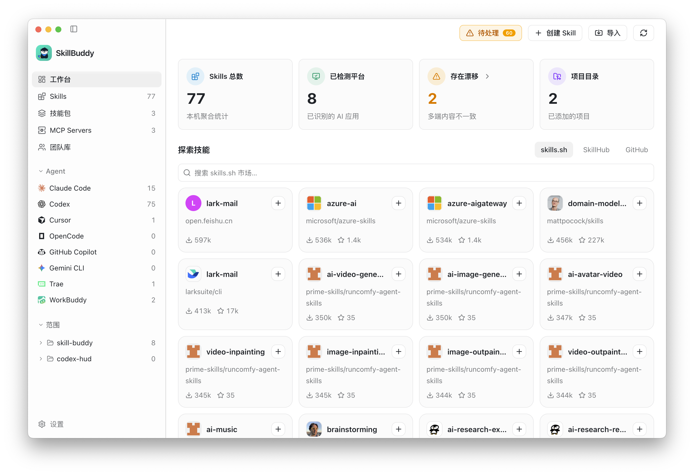
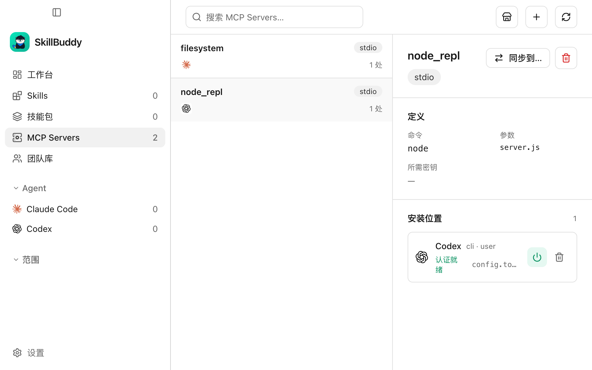
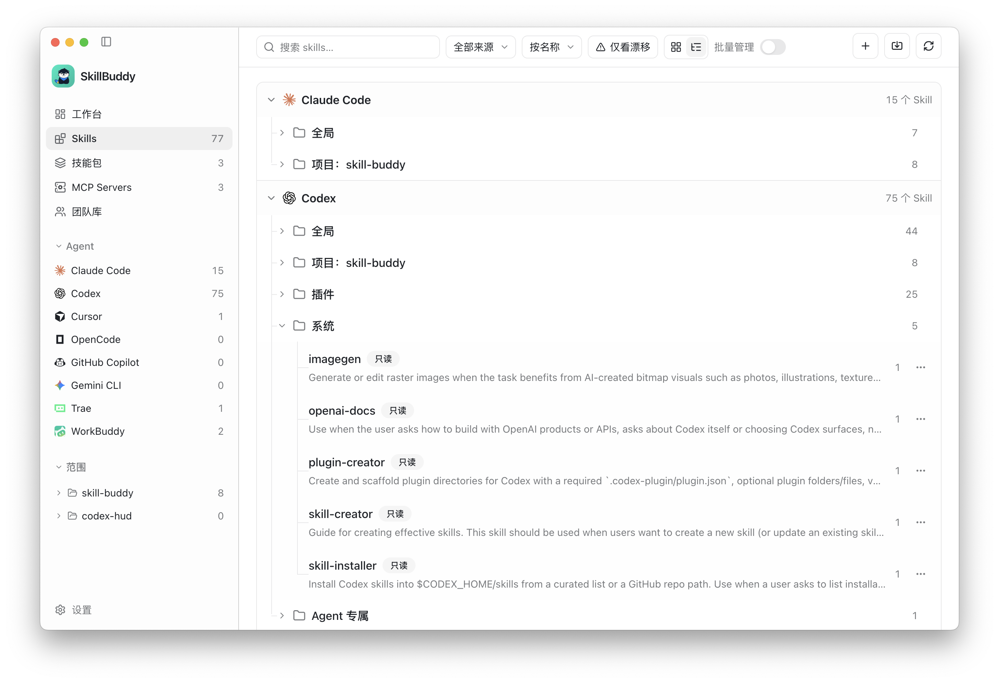
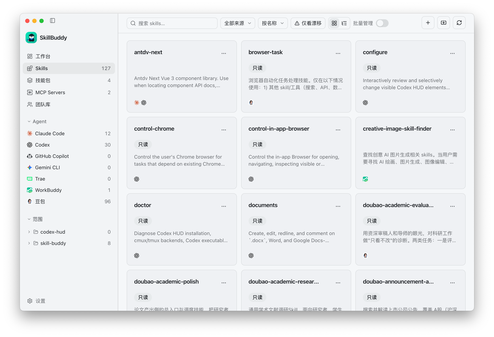
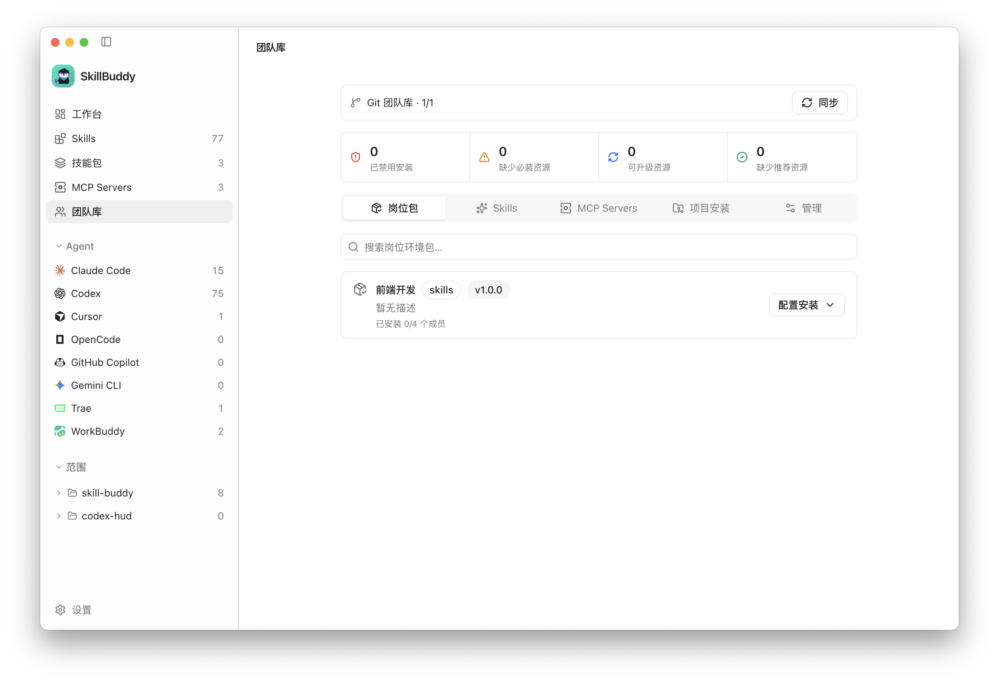
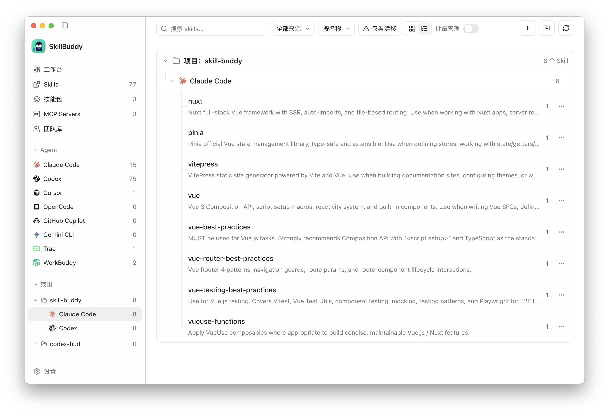
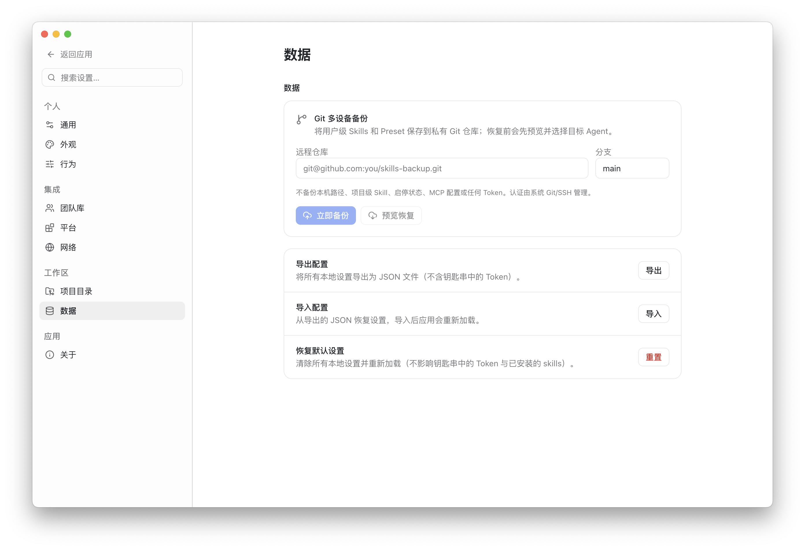
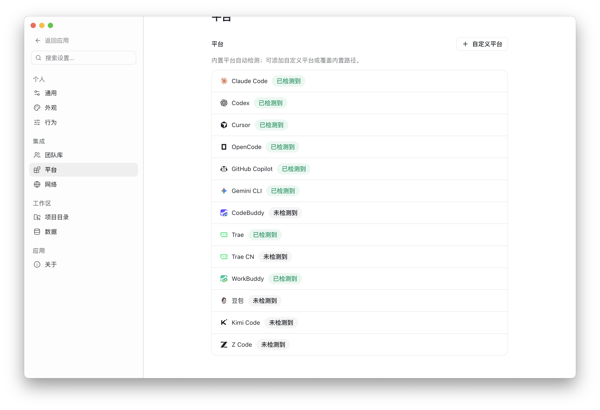

<p align="center">
  
</p>

<h1 align="center">SkillBuddy</h1>

<p align="center">
  A desktop workspace for managing, installing, and synchronizing Skills, MCP Servers, and AI instruction files across AI agents.
</p>

<p align="center">
  English · <a href="README_CN.md">简体中文</a>
</p>

<p align="center">
  
  
  
</p>

SkillBuddy brings Skills, MCP configurations, and AI instruction files scattered across different AI coding tools into one interface. It can inspect local installations, distribute content across platforms, resolve drift and rule-file conflicts, compare what each agent actually loads, discover resources from public marketplaces, and manage reviewed team assets through Git repositories.

## Screenshots

The screenshots below show complete application windows and the main SkillBuddy workflows. The Skills page supports both list and tiled grid views.

<div align="center">
  
  <br />
  <sub>Dashboard: local inventory, detected agents, drift warnings, and marketplace discovery.</sub>
</div>

<div align="center">
  
  <br />
  <sub>MCP Servers: inspect definitions, transports, installation targets, and runtime status.</sub>
</div>

<div align="center">
  
  <br />
  <sub>Skills inventory: browse Skills by Agent, global scope, project scope, plugins, and system resources.</sub>
</div>

<div align="center">
  
  <br />
  <sub>Skills grid view: scan skill names, sources, and summaries in tiled cards.</sub>
</div>

<div align="center">
  
  <br />
  <sub>Team library: sync Git-managed resources, review policy status, and configure role bundles.</sub>
</div>

<div align="center">
  
  <br />
  <sub>Project Skills: inspect project-local resources and compare their installation across Agents.</sub>
</div>

<div align="center">
  
  <br />
  <sub>Data: back up user Skills and Presets to Git, export settings, or restore a previous configuration.</sub>
</div>

<div align="center">
  
  <br />
  <sub>Platforms: review detected Agent integrations and add custom platform paths.</sub>
</div>

## Highlights

- **Unified inventory**: automatically discover and aggregate Skills, MCP Servers, and AI instruction files across agents.
- **Cross-platform installation**: install one Skill into multiple user-level or project-level targets.
- **Drift detection and synchronization**: compare conflicting copies and synchronize from a selected baseline.
- **Enable, disable, and uninstall**: manage writable Skills, with trash and undo support for removal.
- **Skill discovery**: search skills.sh, SkillHub, and GitHub, then inspect content and resources before installation.
- **MCP discovery and change plans**: find MCP Servers, validate target capabilities, and preview exact writes.
- **AI instruction management**: discover `AGENTS.md`, `CLAUDE.md`, `GEMINI.md`, and tool-specific rule files across global and project scopes, then create, edit, or delete them with a reviewed write plan.
- **Effective instruction chains**: see the ordered files each tool actually loads for a directory, and which entries are shadowed or waiting for extra tool configuration.
- **Instruction diagnostics and bridging**: detect broken links, content drift, duplicates, and invalid `@path` imports, then add a Claude Code bridge for projects that only maintain `AGENTS.md`.
- **Presets and bundles**: save reusable Skill sets for batch installation, toggling, import, and export.
- **Private Git backup**: back up user-level Skills, Presets, and global instruction files, then preview restore operations on another device.
- **Git team libraries**: manage reviewed Skills, MCP definitions, project instruction templates, role bundles, and policies through protected branches and PRs/MRs.
- **Project compliance**: declare project requirements in `.skillbuddy/team.yaml` and detect missing, drifted, outdated, blocked, or unresolved resources.
- **Custom platforms**: add another agent by configuring its detection, user, and project paths.
- **Bilingual UI**: Simplified Chinese and English are built in.

## Supported Agents

SkillBuddy includes built-in Skill directory conventions for:

| Agent | User scope | Project scope |
| --- | :---: | :---: |
| Claude Code | ✓ | ✓ |
| Codex | ✓ | ✓ |
| Cursor | ✓ | ✓ |
| OpenCode | ✓ | ✓ |
| Pi | ✓ | ✓ |
| OMP Agent | ✓ | ✓ |
| GitHub Copilot | ✓ | ✓ |
| Gemini CLI | ✓ | ✓ |
| Google Antigravity | ✓ | ✓ |
| Qwen Code | ✓ | ✓ |
| CodeBuddy | ✓ | ✓ |
| Trae / Trae CN | ✓ | ✓ |
| WorkBuddy | ✓ | - |
| Doubao | ✓ | - |
| Kimi Code | ✓ | ✓ |
| ZCode | ✓ | ✓ |
| WPS Lingxi | ✓ | - |
| DeepSeek Harness | ✓ | ✓ |

MCP formats, scopes, and capabilities vary by platform. SkillBuddy displays the detected configuration surfaces and validates every planned change before applying it. Some conventions still need broader real-device feedback; see [Platform conventions](docs/platform-conventions.md).

## AI Instructions

The **AI Instructions** page manages the project rule and context files that AI tools read at session start — the files that otherwise stay scattered across `AGENTS.md`, `CLAUDE.md`, `GEMINI.md`, `CODEBUDDY.md`, and per-tool rule directories.

- **Two scopes**: global instruction files under your home directory, and instruction files anywhere inside the projects you have registered.
- **Per-tool conventions**: each tool's entry file, same-directory precedence, local overlays (`AGENTS.local.md`, `CODEBUDDY.local.md`), overrides (`AGENTS.override.md`), rule directories, and fallback files are modelled separately. Covered at launch: Codex, Cursor, Claude Code, DeepSeek Harness, OpenCode, Pi Coding Agent, CodeBuddy Code, Google Antigravity, Gemini CLI, ZCode, Grok Build, and WorkBuddy.
- **Effective chains**: for a tool and a directory, see the ordered list of files that actually apply — global files first, then project files from the repository root down to that directory — including entries that are fallbacks, shadowed by a higher-precedence file, or waiting for additional tool configuration.
- **Diagnostics**: broken or out-of-project links, `AGENTS.md` and `CLAUDE.md` content drift, duplicated files, and `@path` imports that do not resolve are reported with a severity, and fixable findings are marked as such.
- **Cross-tool bridging**: when a project maintains only `AGENTS.md`, SkillBuddy can create the Claude Code bridge that imports it. A `CLAUDE.md` that already carries its own rules is left untouched instead of being overwritten.
- **Reviewed writes**: creating, editing, deleting, and bridging all go through a plan that lists the affected files and tools, and each applied operation can be undone.

Rule evidence is tracked per tool. A profile that rests only on community evidence or is still unverified is surfaced as a warning instead of a confirmed effective chain; other evidence levels are shown alongside the chain.

## System Support

The SkillBuddy desktop application currently provides the following build targets:

| Operating system | Architecture | Minimum version | Support status |
| --- | --- | --- | --- |
| macOS | Apple Silicon (`arm64`) | macOS 11 Big Sur | Supported, DMG and ZIP |
| macOS | Intel (`x64`) | macOS 11 Big Sur | Supported, DMG and ZIP |
| Windows | `x64` | Windows 10 or later | Supported, NSIS installer and ZIP |
| Windows | `arm64` | Windows 11 | Preview build, NSIS installer and ZIP; real-device verification pending |
| Linux | `x64` | Modern desktop distribution | Supported, AppImage, DEB, and RPM |
| Linux | `arm64` | Modern desktop distribution | Preview build, AppImage, DEB, and RPM; real-device verification pending |

Release assets use the `SkillBuddy-v<version>-<system>-<architecture>.<extension>` naming convention.

- macOS arm64/x64: `SkillBuddy-v<version>-macos-<architecture>.dmg` and `.zip`
- Windows x64/arm64: `SkillBuddy-v<version>-windows-<architecture>.exe` and `.zip`
- Linux x64/arm64: `SkillBuddy-v<version>-linux-<architecture>.AppImage`, `.deb`, and `.rpm` (`x86_64` for x64 builds)

## Download

Download the installer for your system from:

- [Open GitHub Releases](https://github.com/konnga/skill-buddy/releases)
- [Read the changelog](CHANGELOG.md)

### macOS First Launch

The macOS installer uses a complete ad-hoc signature and is not notarized with an Apple Developer ID. Gatekeeper may block it because it is not from an identified developer. After moving the app to `Applications`, open it once, then go to **System Settings → Privacy & Security → Security** and click **Open Anyway**. Confirm the prompt to launch SkillBuddy. You can also control-click the app and choose **Open**. If the security approval button does not appear, use the following fallback for an installer downloaded from the official GitHub Release:

```bash
xattr -dr com.apple.quarantine /Applications/SkillBuddy.app
open /Applications/SkillBuddy.app
```

The `xattr` command only removes the download quarantine attribute and should be used as a last resort. If macOS reports that the app is damaged, do not bypass the warning: download a current installer because that indicates an invalid or incomplete app signature.

The self-hosted Registry service and CLI are separate optional components and are not included in the desktop installer.

SkillBuddy reads the local directories already used by your agents. Installation, synchronization, toggling, and removal only affect targets explicitly selected in the interface.

## Team Workflow

A team can use Git as the source of truth for content, versions, permissions, and audit history:

- Maintainers edit Skills, MCP definitions, bundles, and policies on isolated `skillbuddy/<id>` branches.
- Instruction templates are versioned alongside Skills and MCP definitions and can be applied to registered projects; project compliance reports instruction content that is missing or outdated.
- Instruction requirements declared in `.skillbuddy/team.yaml` can also be enforced in CI: `skm instructions check --project <root> --library <checkout>` compares a project against a local team-library checkout and exits non-zero when required templates are missing or outdated. A copy-ready pull-request workflow ships in `.github/workflows/instructions-check.yml`.
- File lists, validation results, and diffs can be reviewed before publishing.
- GitHub contributions use `gh` to create Pull Requests; GitLab contributions use `glab` to create Merge Requests.
- Regular members browse and install only content that has already been merged.
- Private repository authentication stays with system Git, SSH Agent, or the credential manager. SkillBuddy does not store repository passwords.

See [Git team libraries](docs/team-library.md) for repository formats and the complete workflow.

## Security and Privacy

- SkillBuddy scans and manages local files by default and does not require a SkillBuddy account.
- An optional GitHub token can raise marketplace API limits and is stored through the system secure storage.
- MCP definitions must not contain plaintext tokens, passwords, or API keys. Use environment-variable or secret references.
- Git backup excludes MCP configuration, tokens, absolute machine paths, project-level Skills, and enablement state. Instruction backup is limited to global, writable, non-linked files.
- Read-only system, administrator, and plugin Skills cannot be edited or removed.
- Instruction files are limited to 1 MiB of UTF-8 content, and writes are checked against the previous content hash so a file changed by another program is never overwritten silently.
- Linked instruction files are edited through their source file, and deleting a link removes only the link itself.
- Main-process path validation prevents writes outside managed roots and rejects symlink escapes.

## Repository Layout

```text
skill-buddy/
├── apps/
│   ├── desktop/       # Electron + Vue 3 desktop app
│   └── registry/      # Optional self-hosted Fastify + SQLite registry
├── packages/
│   ├── core/          # Canonical models, scanning, aggregation, adapters, instruction rules, and validation
│   └── cli/           # skm command-line interface
└── docs/              # Design, platform, registry, and team-library documentation
```

The desktop team workflow uses Git team libraries and does not depend on the Registry. The Registry and CLI remain available in the monorepo as optional self-hosting and automation components.

## Development

Requirements:

- Node.js 22 or later
- pnpm 10 or later
- Git

```bash
pnpm install
pnpm dev
```

Common commands:

```bash
pnpm build       # Build every workspace package
pnpm test        # Run unit tests
pnpm test:e2e    # Build and run Electron end-to-end tests
pnpm typecheck   # Type-check the complete repository
```

## Contributing

Issues and Pull Requests are welcome. Before submitting a change, please try to:

1. Include the affected platform, scope, and reproduction steps.
2. Add coverage for shared logic when appropriate.
3. Run the type checks or tests relevant to the change.
4. Avoid committing real tokens, local paths, or private team content.

## License

SkillBuddy is released under the [MIT License](LICENSE).
